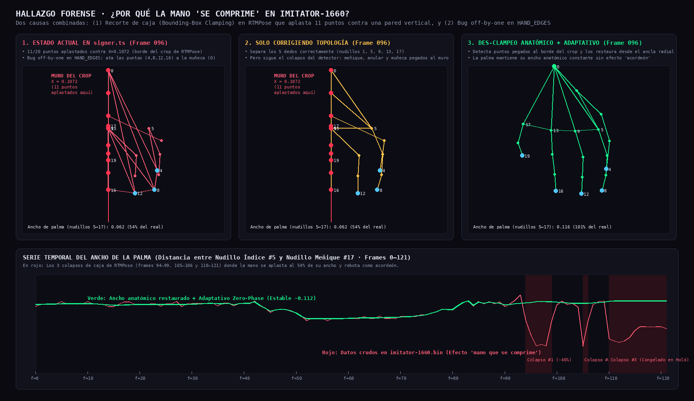
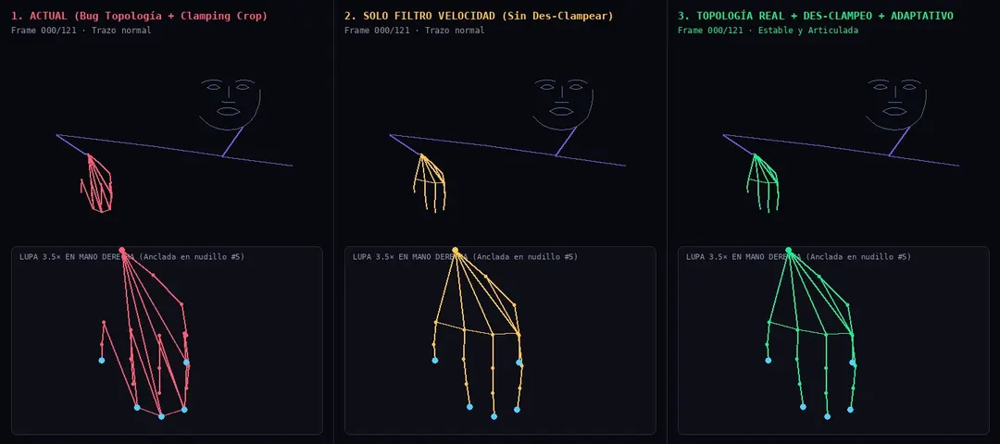
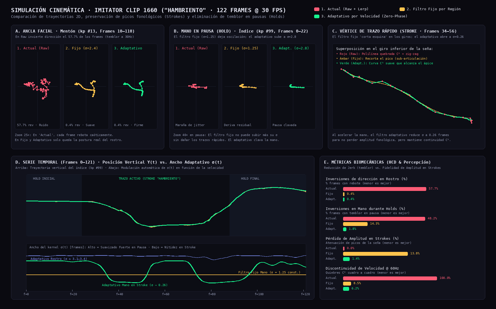
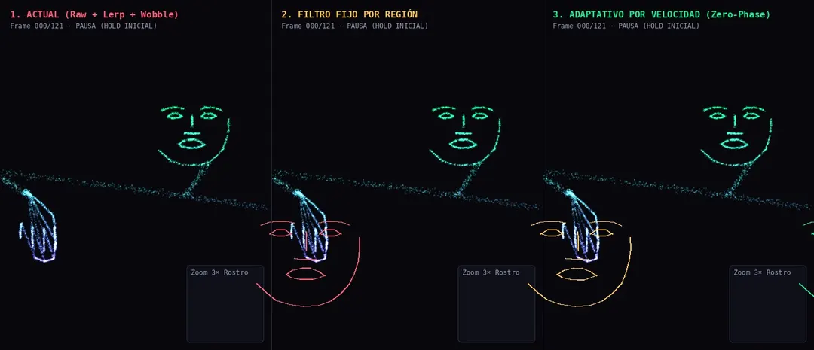

# Diagnóstico Forense y Simulación: Temblor + Compresión de la Mano en Imitator (Clip 1660)

> [!CAUTION]
> **Hallazgo clave sobre por qué la mano "se comprime":**
> Al inspeccionar los valores `uint16` de la mano derecha (`kp[91..110]`) cuadro por cuadro en [`imitator-1660.bin`](../../../site/public/assets/deck/imitator-1660.bin), aparecieron **dos causas exactas** que explican por qué la mano se aplasta como acordeón, y por qué un filtro de velocidad por sí solo no bastaba para corregirlo:
>
> 1. **Recorte de caja (*Bounding-Box Left-Wall Clamping*) en RTMPose (frames `94–99`, `105–106` y `110–121`):**
>    Cuando la mano derecha regresa hacia el costado derecho del cuerpo (izquierda de la imagen), el *crop* detector de RTMPose corta en $X \approx 0.1072$ (`uint16 = 7025`). Como resultado, **11 de los 20 puntos de la mano (muñeca, anular, meñique y nudillo medio) chocan contra esa pared vertical invisible y quedan con exactamente la misma coordenada $X = 0.1072$**, reduciendo el ancho de la palma al **54 %** en 2 frames, rebotando al 100 % en el frame `101`, volviendo a aplastarse en el `105` y quedándose comprimida en el `hold` final (`110–121`).
> 2. **Bug *off-by-one* en `HAND_EDGES` dentro de [`signer.ts`](../../../site/src/scripts/signer.ts):**
>    En los 20 puntos de mano de `imitator-1660.bin`, el índice `0` es la **muñeca**, `1, 5, 9, 13, 17` son los **nudillos (MCP)** y `4, 8, 12, 16, 19` son las **puntas de los dedos**. Pero `signer.ts` iteró `f * 4` asumiendo que `0, 4, 8, 12, 16` eran los nudillos: **ató las puntas de los dedos entre sí y directo a la muñeca (`[0,4], [0,8], [0,12], [0,16]`)**, convirtiendo la mano abierta en una telaraña cerrada.

---

## 1. Prueba Visual del Muro de Compresión y su Restauración Anatómica

---

## 2. Animación con Lupa 3.5× en la Mano Derecha (3 Columnas)

Observa en la lupa inferior qué ocurre a partir del **Frame 094**:
* **Columna 1 (Actual):** La mitad izquierda de la mano choca contra el muro rojo (`MURO CROP`), se aplasta en una línea vertical, rebota dos veces como acordeón y además tiene las puntas atadas a la muñeca.
* **Columna 2 (Solo Filtro Velocidad):** Corrige los 5 dedos, pero como el colapso del *crop* ocurre a gran velocidad, el filtro cree que es un movimiento real y **la mano se sigue comprimiendo contra el muro**.
* **Columna 3 (Topología Real + Des-Clampeo Anatómico + Adaptativo Zero-Phase):** Detecta automáticamente qué puntos tocaron el borde del *crop* ($\Delta X < 2.5\times 10^{-4}$ respecto al mínimo del frame), los reconstruye anclados al lado radial no truncado de la mano (nudillo índice `#5`), y aplica el filtro adaptativo de fase cero con splines Catmull-Rom $C^1$.

---

## 3. Simulación General de la Nube de Partículas y Series Temporales

---

## 4. Formulación Zero-Phase Velocity & Directional-Coherence Adaptive en `signer.ts`

Como en [`signer.ts`](../../../site/src/scripts/signer.ts) los 122 frames están en memoria al inicializar `loadSigner()`, combinamos **velocidad neta** con **coherencia direccional** en una ventana simétrica $[f-2, f+2]$:

$$v_{\text{net}}(f) = \frac{\|\mathbf{p}_{f+2} - \mathbf{p}_{f-2}\|}{4}, \qquad v_{\text{path}}(f) = \frac{1}{4}\sum_{k=f-2}^{f+1} \|\mathbf{p}_{k+1} - \mathbf{p}_k\|$$

$$\text{Coherencia } \eta(f) = \frac{v_{\text{net}}(f)}{v_{\text{path}}(f) + \varepsilon} \in [0, 1]$$

* **Cuando hay temblor del detector (Jitter):** El punto va y viene ($\mathbf{p}_{f+1}$ sube, $\mathbf{p}_{f+2}$ baja). La distancia recorrida $v_{\text{path}}$ es alta, pero el desplazamiento neto $v_{\text{net}}$ es casi cero $\implies \eta(f) \to 0 \implies \sigma(f) \to \sigma_{\max}$ (**suavizado máximo**).
* **Cuando hay un trazo real de la seña (Stroke):** Los 4 pasos apuntan en la misma dirección $\implies \eta(f) \to 1$ y $v_{\text{net}}$ es alta $\implies \sigma(f) \to \sigma_{\min}$ (**preservación total del gesto**).
* **Interpolación $C^1$ Catmull-Rom en `poseAt()`:** Sustituye el `lerp` lineal entre `f0` y `f1` por una spline cúbica que garantiza velocidad continua a 60/120 Hz.
